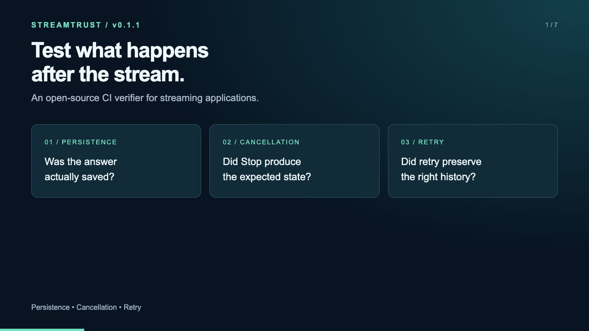

# StreamTrust CLI

[](https://www.npmjs.com/package/streamtrust)

**[View StreamTrust on npm](https://www.npmjs.com/package/streamtrust)**

Adapter-driven CI checks for streaming applications: compare observed output with authoritative state, exercise cancellation, and verify retry identity.

**Status:** `0.1.1`, an early 0.x release for independent teams. APIs and report formats may change before 1.0. The CLI is dependency-free, ESM, and requires Node.js 22+. MIT licensed. Browser and database libraries belong to your adapter and are not installed by StreamTrust.

## Watch the 60-second demo

[](https://github.com/santoshsibyala/streamtrust/blob/main/docs/media/streamtrust-demo-0.1.1.mp4)

**[Watch the demo](https://github.com/santoshsibyala/streamtrust/blob/main/docs/media/streamtrust-demo-0.1.1.mp4)** · [Download MP4](https://raw.githubusercontent.com/santoshsibyala/streamtrust/main/docs/media/streamtrust-demo-0.1.1.mp4)

A captioned walkthrough with no audio: install StreamTrust, run the example checks, inspect the diagnostic report, and see a deliberate save failure return a nonzero CI exit code. Recorded with version 0.1.1. The bundled application and injected failure are demonstrations; connect an adapter to your own application to verify its behavior.

## Install

```sh
npm install --save-dev streamtrust
npx streamtrust init
npx streamtrust verify --adapter ./streamtrust/adapter.mjs
```

For reproducible CI, pin `streamtrust@0.1.1` and commit your lockfile. The generated adapter initially exercises the bundled demonstration; map it to your application before using its results as application evidence.

## Run from source

```sh
git clone https://github.com/santoshsibyala/streamtrust.git
cd streamtrust
node bin/streamtrust.js init demo
node bin/streamtrust.js verify --adapter ./demo/adapter.mjs
```

Node.js 22+ is required. No dependency installation is needed to run this CLI or its tests. Run `npm test` to check the source, or `npm pack` to build an installable tarball. This repository contains the standalone CLI; the separate experimental application harnesses are not included.

## Quick start: install a locally built tarball

Build the tarball with `npm pack` in this repository.

Put the supplied tarball in your project's `vendor/` directory, then:

```sh
npm install --save-dev ./vendor/streamtrust-0.1.1.tgz
npx streamtrust init
npx streamtrust verify --adapter ./streamtrust/adapter.mjs
```

`init` creates `streamtrust/adapter.mjs` and `streamtrust/demo-app.mjs`. Existing files are never overwritten. Commit your adapted files and package-lock.json.

Without `STREAMTRUST_BASE_URL`, the example starts an isolated local HTTP/SSE service with temporary file-backed state. It checks persistence, cancellation and retry, three times each. It requires no API key, browser, Redis or database installation. The fixture is removed at the end of the run.

**The demonstration passing says nothing about your own application's reliability.** Replace the route mappings and assertions before using the result as application evidence.

Reports appear in `reports/streamtrust/`:

- `report.json`: versioned results, named assertions, evidence, metadata, run ID and suite errors.
- `junit.xml`: test results for CI consumers.
- `report.md` and `index.html`: human-readable diagnostics.

## Connect your application

The generated adapter is executable JavaScript. Map each scenario to your app's native operations and persistence contract. The bundled example uses this teaching protocol:

| Operation | Example mapping |
|---|---|
| Start | `POST /runs` → `{id, parentId, status, content}` |
| Observe stream | `GET /runs/:id/events` → SSE `text` and `terminal` JSON events |
| Release model fixture | `POST /runs/:id/complete` |
| Cancel | `POST /runs/:id/cancel` → `{accepted}` |
| Retry | `POST /runs/:id/retry` → a new run linked to the old run |
| Authoritative read | `GET /runs/:id` → saved state |

The completion route is a test-fixture control, not an endpoint you must add to production. An adapter can instead control a deterministic provider, use Playwright to click the real Stop button, or read your database directly. Preserve your app's semantics: for example, regeneration may create a branch instead of replacing history. Do not invent commit receipts or cancellation guarantees your app does not expose.

For an existing test service implementing this protocol:

```sh
STREAMTRUST_BASE_URL=http://127.0.0.1:8080 \
  npx streamtrust verify --adapter ./streamtrust/adapter.mjs \
  --output reports/streamtrust --repetitions 3 --timeout-ms 300000
```

The example optionally reads `STREAMTRUST_API_TOKEN` for bearer authentication, but does not put the token or authorization headers in reports. Run against a disposable test environment: these scenarios create, complete, cancel and retry operations. Adapters are trusted code and can access the same filesystem/network as your CI job. StreamTrust does not sandbox them or automatically redact arbitrary evidence. Return only the diagnostics you want uploaded as artifacts.

## Adapter contract

Export a default async factory. The CLI supplies `{outputDir, signal}`. Return:

```js
export default async function createAdapter({ signal }) {
  return {
    name: 'My application',
    scenarios: ['persistence'],
    async metadata() {
      return { appRevision: process.env.APP_REVISION ?? 'unknown' };
    },
    async run(scenario, { repetition, outputDir, signal }) {
      // Replace these calls with real observations in your adapter.
      const displayed = await observeApplication(signal);
      const saved = await readAuthoritativeState(signal);
      return {
        checks: [{
          name: 'Displayed answer matches saved answer',
          passed: displayed.text === saved.text,
        }],
        evidence: { displayed, saved },
      };
    },
    async close() {
      // Close browsers, connections and services owned by this adapter.
    },
  };
}
```

The snippet illustrates the contract; `observeApplication` and `readAuthoritativeState` are your implementation. The generated HTTP adapter is the complete runnable example.

Scenarios must be unique identifiers containing letters, digits, `_`, `-` or `.`. Assertions must have unique nonempty names and **boolean** `passed` values. Empty or malformed checks are harness errors. Unknown extra result fields cannot override the verdict. Evidence must be JSON-serializable. Unsupported capabilities return `{ checks: [], evidence: {}, unsupported: 'Reason' }`; they do not count as passes.

The runner calls metadata before and after the suite, and calls close even when execution or validation fails. If your factory fails before returning an adapter, clean up resources in the factory's catch/finally. Use `signal` in network calls and release resources cooperatively. A failed assertion means the stated contract failed; it does not automatically identify a library defect.

Types are exported from `streamtrust`: `ExternalAppAdapter`, `AdapterFactory`, `ExternalObservation`, `Check`, `Report`. The programmatic `runVerification(adapter, outputDir, repetitions)` returns a report; inspect `report.exitCode`. Only the CLI provides a separate watchdog process.

JavaScript `.mjs` adapters work out of the box. For TypeScript adapters, install your own loader:

```sh
npm install --save-dev tsx
node --import tsx ./node_modules/streamtrust/bin/streamtrust.js verify \
  --adapter ./streamtrust/adapter.ts
```

## CI

Add StreamTrust as a test step in your existing CI. For GitHub Actions, follow these steps:

1. Install StreamTrust and create the starting adapter:

   ```sh
   npm install --save-dev --save-exact streamtrust@0.1.1
   npx streamtrust init
   ```

2. Adapt `streamtrust/adapter.mjs` to your application's native start, stream, cancel, retry, and saved-state operations. **The generated adapter initially tests a bundled demo. Setting a base URL alone does not adapt it to arbitrary application APIs.** See [Connect your application](#connect-your-application) above.
3. Commit the adapter, `package.json`, and `package-lock.json`. If the adapter imports browser or database libraries, add those dependencies and their required CI setup too.
4. Save the workflow below as `.github/workflows/streamtrust.yml`, or copy its relevant steps into an existing job.

**Replace `npm run start:test`, port `3000`, and `/health` with your application's test-server command and readiness endpoint.** These are placeholders, not commands or routes supplied by StreamTrust. Add any required build, database, migration, fixture, or browser-install steps before starting your app. Use a disposable test environment because the checks create and modify application state.

```yaml
name: Streaming application verification
on: [push, pull_request]
permissions:
  contents: read
jobs:
  verify:
    runs-on: ubuntu-latest
    timeout-minutes: 10
    steps:
      - uses: actions/checkout@v4

      - uses: actions/setup-node@v4
        with:
          node-version: 22
          cache: npm

      - run: npm ci

      # Add your application's build and test-service setup here.
      - name: Start application and wait for readiness
        shell: bash
        run: |
          npm run start:test > app.log 2>&1 &
          app_pid=$!
          for attempt in {1..30}; do
            if ! kill -0 "$app_pid" 2>/dev/null; then
              cat app.log
              exit 1
            fi
            if curl --fail --silent --max-time 2 http://localhost:3000/health; then
              exit 0
            fi
            sleep 2
          done
          cat app.log
          echo "Application did not become ready in time."
          exit 1

      - name: Verify streaming behavior
        run: |
          npx --no-install streamtrust verify \
            --adapter ./streamtrust/adapter.mjs \
            --output ./reports/streamtrust
        env:
          STREAMTRUST_BASE_URL: http://localhost:3000

      - name: Save diagnostic reports
        if: always()
        uses: actions/upload-artifact@v4
        with:
          name: streamtrust-reports
          path: reports/streamtrust/
```

If your application is already running in the job, omit the startup step and point your adapter at its test URL. For the bundled HTTP adapter's optional bearer authentication, add `STREAMTRUST_API_TOKEN: ${{ secrets.TEST_APP_TOKEN }}` to the verification step's `env`, and configure that secret in GitHub. Fork pull requests generally do not receive repository secrets; use a suitable unauthenticated test fixture or an explicitly trusted workflow for those runs. Never put credentials in the adapter or uploaded evidence.

A failed assertion or harness error fails the verification step. The report-upload step runs even after a failure, so teams can inspect diagnostics when they were generated; startup failures may have no StreamTrust report. To block merging, configure the repository's branch protection or ruleset to require this workflow's `verify` check. StreamTrust does not configure merge rules itself.

If you use a locally built tarball instead of npm, keep it in `vendor/` and commit the corresponding file dependency and lockfile so `npm ci` can resolve it.

| Exit | Meaning |
|---|---|
| 0 | Every declared scenario and assertion passed. |
| 1 | Failed assertions or explicitly unsupported scenarios. |
| 2 | Invalid arguments/adapter, setup or cleanup failure, malformed observations, interrupted process or timeout. |

Use a unique output directory per concurrent job. The CLI takes an exclusive lock and records a fresh run ID; it cannot reuse an old passing report after setup failure. Reports are overwritten on subsequent runs. If a process was forcibly killed, remove a stale `.streamtrust.lock` only after confirming that process has stopped. Invalid arguments and lock contention fail before a run starts and do not replace existing evidence.

`--timeout-ms` bounds the entire invocation, including factory setup and cleanup (default five minutes), followed by up to one second of termination grace. On Linux/macOS the CLI terminates its worker process group, including ordinary child processes. Adapters that detach external services must arrange their own cleanup. Windows process-tree cleanup is not validated in this release. An outer CI timeout remains useful.

## Scope and attribution

StreamTrust checks what an adapter asserts. It does not prove exactly-once external effects, AI factuality, automatic recovery, production incident rates or adoption. The HTTP demo is synthetic. Separate development experiments have tested pinned Vercel Chatbot and LibreChat applications; their adapters and dependencies are not bundled here.

Local preparation: `npm pack` in this package directory runs the package tests and creates the tarball. The public repository runs tests and a clean tarball installation on Node.js 22 and 24. This release is published interactively; npm build provenance is not configured.
